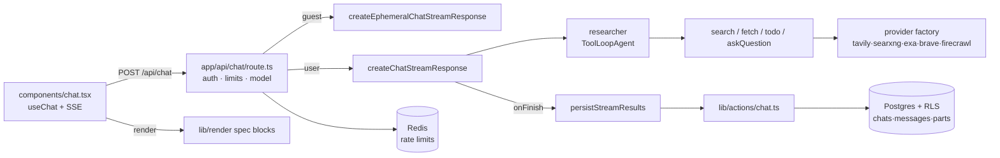

# System Map

## Repo shape

Single Next.js 16 app (not a monorepo). One `package.json`, one deployable unit. Bun is the package manager and script runner ([package.json#L107-L109](../../package.json#L107-L109) pins `bun 1.2.12`).

```
morphic/
├── app/                    # Next.js App Router: pages + API routes (HTTP boundary)
│   ├── api/                #   chat, chats, upload, feedback, advanced-search
│   ├── auth/               #   login/signup/reset pages + oauth/confirm routes
│   └── search/[id]/        #   saved-chat page
├── components/             # React components (client-heavy); ui/ = shadcn primitives
├── hooks/                  # client hooks (dropzone, shortcuts, media query)
├── lib/                    # ALL business logic lives here
│   ├── agents/             #   researcher agent + title generator + prompts
│   ├── tools/              #   AI tools: search, fetch, question, todo (+ search/providers/)
│   ├── streaming/          #   stream response builders + message prep/persist helpers
│   ├── db/                 #   Drizzle schema, RLS wrapper, low-level DB actions
│   ├── actions/            #   'use server' actions (chat CRUD, feedback) — app-level API
│   ├── auth/ supabase/     #   identity
│   ├── rate-limit/         #   Redis daily limits (guest / overall / adaptive)
│   ├── config/ models/     #   model selection stack
│   ├── render/             #   generative-UI spec system (json-render)
│   ├── schema/             #   Zod input schemas for tools
│   └── utils/              #   registry, context-window, citations, message mapping…
├── drizzle/                # generated SQL migrations + snapshots (do not hand-edit)
├── config/models/cloud.json# pinned models for cloud deployment
├── proxy.ts                # Next middleware (session refresh + base-URL headers)
└── scripts/                # chat-cli, cache perf script
```

## Ownership map

| Concern | Owner | Must NOT own |
| --- | --- | --- |
| HTTP parsing, status codes | [app/api/*](../../app/api/chat/route.ts) | business rules (delegates to lib/) |
| Chat orchestration | [lib/streaming/](../../lib/streaming/create-chat-stream-response.ts) | SQL (delegates to lib/actions → lib/db) |
| Agent behavior & prompts | [lib/agents/](../../lib/agents/researcher.ts) | persistence |
| Tool execution | [lib/tools/](../../lib/tools/search.ts) | UI shapes (returns provider-normalized `SearchResults`) |
| Search vendor specifics | [lib/tools/search/providers/](../../lib/tools/search/providers/index.ts) | anything above the `SearchProvider` interface |
| Authorization + tenant isolation | [lib/db/schema.ts](../../lib/db/schema.ts#L53-L67) RLS + [lib/db/with-rls.ts](../../lib/db/with-rls.ts) | — (defense in depth: app checks too, e.g. [create-chat-stream-response.ts#L64-L70](../../lib/streaming/create-chat-stream-response.ts#L64-L70)) |
| Cache lifecycle | [lib/actions/chat.ts](../../lib/actions/chat.ts#L17-L34) (`unstable_cache` + `revalidateTag`) | — |
| Client chat state | [components/chat.tsx](../../components/chat.tsx) via `useChat` | server persistence |
| Identity | [lib/auth/get-current-user.ts](../../lib/auth/get-current-user.ts) + [proxy.ts](../../proxy.ts) | authorization decisions per-row (that's RLS) |

**Boundary** (interview word): a line where responsibility changes hands and a *contract* holds. The cleanest one here is `SearchProvider` — five vendors behind one method signature ([providers/index.ts#L16-L37](../../lib/tools/search/providers/index.ts#L16-L37)). The leakiest one: `lib/tools/search.ts` knows Brave takes extra args ([search.ts#L114-L127](../../lib/tools/search.ts#L114-L127)) — a boundary leak worth studying in [03-architecture-and-patterns/01-boundaries-and-layers.md](../03-architecture-and-patterns/01-boundaries-and-layers.md).

## Flow diagram



## Public interfaces vs private internals

**Public (contracts you must not casually change):**
- `POST /api/chat` body: `{ message, messages, chatId, trigger, messageId, isNewChat }` ([route.ts#L30-L31](../../app/api/chat/route.ts#L30-L31)) — the client builds this in [chat.tsx#L102-L129](../../components/chat.tsx#L102-L129).
- `GET /api/chats?offset&limit` ([app/api/chats/route.ts#L11-L26](../../app/api/chats/route.ts#L11-L26)).
- `POST /api/upload` multipart ([app/api/upload/route.ts#L15-L70](../../app/api/upload/route.ts#L15-L70)).
- The **DB schema** — a contract with your own history: old rows must remain loadable (see the spec migration precedent in [lib/render/migrations.ts](../../lib/render/migrations.ts) usage at [parse-spec-block.ts#L94-L99](../../lib/render/parse-spec-block.ts#L94-L99)).
- The **prompt↔UI citation contract**: `[n](#toolCallId)` ([prompts](../../lib/agents/prompts/search-mode-prompts.ts#L72-L101) ↔ [citation.ts#L83](../../lib/utils/citation.ts#L83)). Change one side, break the other.

**Private:** everything in `lib/` not re-exported to a route; `components/ui/*` (generated shadcn); `drizzle/*` (generated).

## Drill

Without opening the answer: which file would you edit to (a) add a rate limit for uploads, (b) add a new search vendor, (c) change what a "quick mode" search is allowed to do? Then verify: (a) [app/api/upload/route.ts](../../app/api/upload/route.ts) + a new `lib/rate-limit/` module, (b) new file in [lib/tools/search/providers/](../../lib/tools/search/providers/index.ts) + factory case, (c) [researcher.ts#L92-L101](../../lib/agents/researcher.ts#L92-L101).

Self-grade — Basic: found the directory. Solid: named the exact files and the factory registration. Strong: also named the contract each change must preserve (429 shape; `SearchProvider` signature; `activeTools` list + forced `optimized` type).
