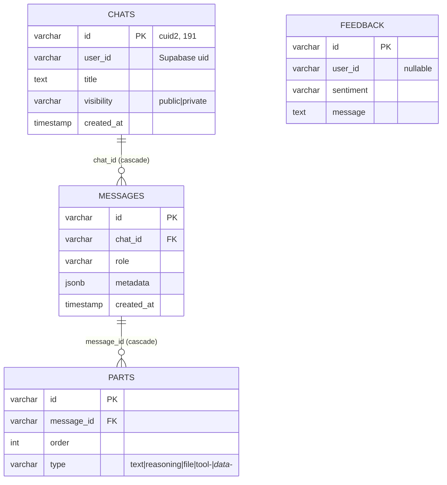

# Data Model and Persistence

## The entities

Notes that matter:
- **No `users` table.** Identity lives in Supabase; `user_id` is a plain varchar ([schema.ts#L34](../../lib/db/schema.ts#L34)). Consequence: no FK to users, no cascade when a user is deleted (orphaned chats — *possible risk*, GDPR-adjacent), and the app can run with made-up ids in anonymous mode.
- **cuid2 ids, client-generatable** ([schema.ts#L23](../../lib/db/schema.ts#L23), used in the browser at [chat.tsx#L58](../../components/chat.tsx#L58)). This single choice enables optimistic chat creation (Pattern 6). Contrast serial ids: the client would have to wait for the server.
- **Cascade deletes** chats→messages→parts ([schema.ts#L79-L81](../../lib/db/schema.ts#L79-L81), [L129-L131](../../lib/db/schema.ts#L129-L131)): deleting a chat is one statement ([db/actions.ts#L336-L337](../../lib/db/actions.ts#L336-L337)).
- **`parts.order` + delete-and-reinsert** keeps part ordering trivially consistent ([db/actions.ts#L110-L118](../../lib/db/actions.ts#L110-L118); re-indexed after filtering at [message-mapping.ts#L336-L338](../../lib/utils/message-mapping.ts#L336-L338)).

## Indexes — each one answers a query

| Index | Query it serves | Anchor |
| --- | --- | --- |
| `chats_user_id_created_at_idx` | sidebar history: newest chats per user, paginated | [schema.ts#L45-L48](../../lib/db/schema.ts#L45-L48) ↔ [db/actions.ts#L294-L301](../../lib/db/actions.ts#L294-L301) |
| `chats_id_user_id_idx` | **the RLS subquery** on messages/parts policies | [schema.ts#L50-L51](../../lib/db/schema.ts#L50-L51) — the comment says exactly this; RLS is not free, you index for it |
| `messages_chat_id_created_at_idx` | load a chat's messages in order | [schema.ts#L88-L89](../../lib/db/schema.ts#L88-L89) |
| `parts_message_id_order_idx` | ordered parts per message | [schema.ts#L204-L205](../../lib/db/schema.ts#L204-L205) |

Interview-ready sentence: "every index in that schema is traceable to a specific query or policy — that's the standard I hold PRs to."

## Transaction boundaries and consistency

**Transaction = the unit that must be all-or-nothing.** Three real boundaries:

1. Chat + first message + parts, one transaction ([db/actions.ts#L394-L441](../../lib/db/actions.ts#L394-L441)) — a chat with a half-saved first message must be impossible.
2. Message upsert + parts replace, one transaction ([db/actions.ts#L98-L118](../../lib/db/actions.ts#L98-L118)) — readers never observe a partless message.
3. *Every* RLS operation is a transaction by construction, because `set_config(..., local=true)` needs one ([with-rls.ts#L44-L54](../../lib/db/with-rls.ts#L44-L54)).

**Consistency expectations elsewhere are deliberately weaker:** the assistant's answer streams to the user before any row exists (Flow 1); title arrives later ([persist-stream-results.ts#L100-L108](../../lib/streaming/helpers/persist-stream-results.ts#L100-L108)); caches are 60s-stale-tolerant ([lib/actions/chat.ts#L29-L30](../../lib/actions/chat.ts#L29-L30)). Being able to say *which* parts of a system are strongly consistent and which are eventually consistent — and why — is a senior marker.

Known wart (*confirmed by reading, impact unverified*): the message upsert's conflict branch updates only `role` ([db/actions.ts#L104-L107](../../lib/db/actions.ts#L104-L107)) — a re-saved message keeps its old `metadata`. Parts are replaced, metadata isn't. If a regenerated message reuses an id with new `traceId` metadata, the old trace sticks.

## Reading the query layer

Drizzle in two styles: SQL-builder (`tx.select().from(chats).where(...)`) and relational (`tx.query.messages.findMany({ with: { parts } })`, [db/actions.ts#L137-L145](../../lib/db/actions.ts#L137-L145)). The relational style avoids the classic N+1: messages and their parts arrive without a per-message query. Where N+1 *does* live: `clearChats` loops `deleteChat` per chat ([lib/actions/chat.ts#L229-L233](../../lib/actions/chat.ts#L229-L233)) — N transactions, each with an ownership re-check. Fine at 10 chats; a hotspot at 10,000.

Connection policy ([db/index.ts](../../lib/db/index.ts)): pool max 20 ([L57](../../lib/db/index.ts#L54-L58)), `prepare: false` (transaction-pooler compatibility), prefer the **restricted user** so RLS binds ([L25-L28](../../lib/db/index.ts#L25-L28)) — table owners bypass RLS; that's why this line is security-relevant, not a config nicety.

## How to change the schema safely (this repo's recipe)

1. Edit [lib/db/schema.ts](../../lib/db/schema.ts) only — never the SQL in [drizzle/](../../drizzle/).
2. `drizzle-kit generate` (inferred) → review the generated SQL like code. Ask: does it lock? (`ALTER TABLE ... ADD COLUMN` nullable = cheap; `NOT NULL` without default on a big table = rewrite + lock.)
3. Additive first: new columns nullable or defaulted; backfill separately; tighten constraints last. The `parts` table's sparse columns make this natural — adding `tool_weather_input` is additive.
4. `bun migrate` locally ([lib/db/migrate.ts](../../lib/db/migrate.ts)), run the RLS integration test against real Postgres ([rls-policies.integration.test.ts](../../lib/db/__tests__/rls-policies.integration.test.ts)).
5. Rollback story: migrations here are forward-only (no down files in [drizzle/](../../drizzle/)) — so "rollback" = write a new inverse migration. Say that in interviews; pretending down-migrations always exist is a junior tell.
6. Old data keeps loading: any change to part shapes needs the mapping layer to tolerate old rows — precedent: spec migrations ([render/migrations.ts](../../lib/render/migrations.ts) applied at [parse-spec-block.ts#L94-L99](../../lib/render/parse-spec-block.ts#L94-L99)).

## Drills

1. Write the SQL you'd expect for "sidebar page 2" and check it against [getChatsPage](../../lib/db/actions.ts#L288-L314). Then explain why offset pagination degrades at large offsets and what keyset pagination on `(created_at, id)` looks like (fake code, label it). Uses the existing composite index?
2. A PM asks for "pin a chat". Design the change: column vs join-table, index, migration steps, RLS impact, cache-invalidation points. Self-grade — Strong: boolean column + partial index consideration + no RLS change needed (same owner rule) + `revalidateTag('chat')` audit.

## Interview angle

- "Design a chat data model" — Q23; you have a real one with a defensible wide-table decision and its costs.
- "What's a transaction? Show a real boundary." — chat+first-message; and the RLS-forces-transactions insight is a differentiator. (Q25)
- "How do you ship a schema change with zero downtime?" — the additive-backfill-tighten recipe above. (Q27)
